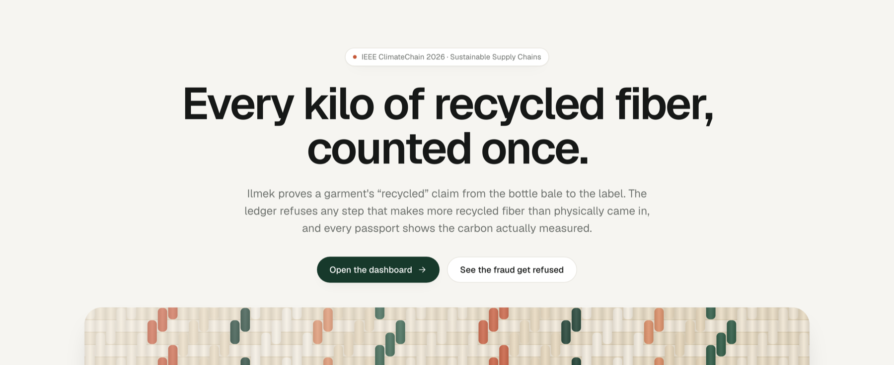
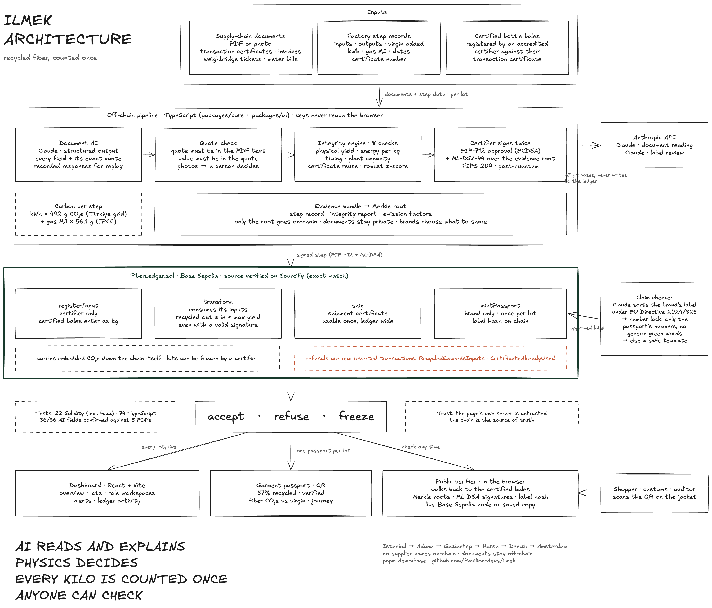
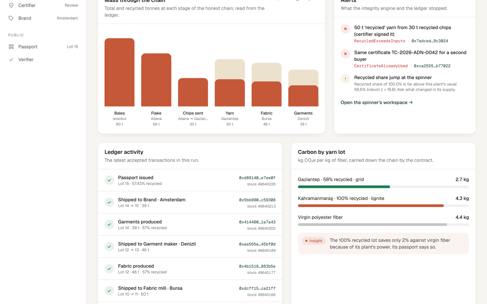
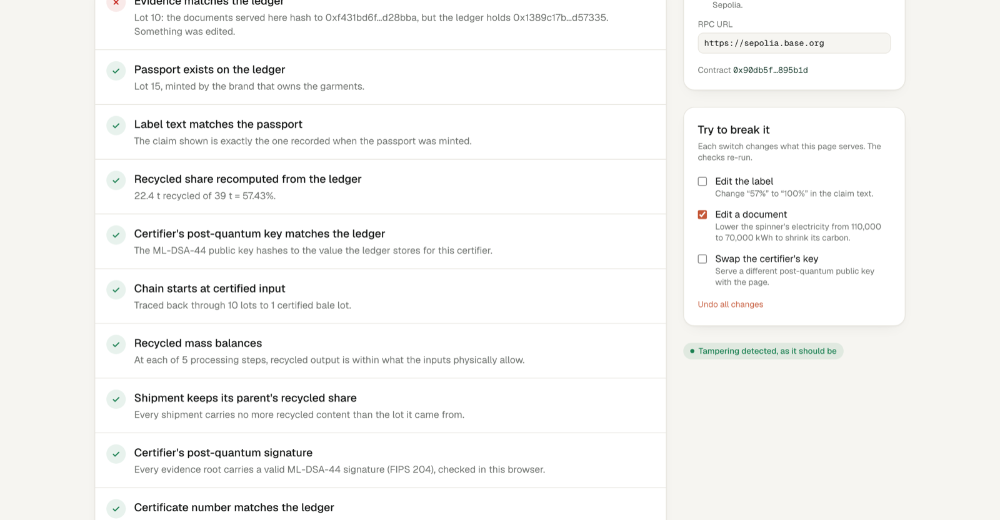

# Ilmek — Every Kilo of Recycled Fiber, Counted Once

> Proof that a garment's **"recycled"** claim is true, in kilograms and kg CO₂e, from
> the bottle bale to the label. A mass-balance ledger on **Base** refuses any step that
> makes more recycled fiber than physically came in, **Claude** reads the supply-chain
> paperwork with every value tied to a quote, and a **post-quantum-signed** garment
> passport can be verified by anyone, in the browser, without trusting us.

Built for the **[IEEE ClimateChain Global Hackathon 2026](https://ieee-climatechain-hack.devpost.com/)** —
Track: Sustainable Supply Chains (also touches Carbon Markets & Emissions Transparency).

---

## Live

- 🎥 **Demo video** — https://youtu.be/ve1jRTqOxKY
- 🌐 **Live demo** — https://ilmek-delta.vercel.app
- 🏷️ **Garment passport (what a shopper scans)** — https://ilmek-delta.vercel.app/#/passport/15
- 🔎 **Public verifier, reading Base Sepolia live** — https://ilmek-delta.vercel.app/#/verify/15?src=live
- 📜 **Contract** — [`0x90db5fde6310022c5f478bbb84e264455e895b1d`](https://sepolia.basescan.org/address/0x90db5fde6310022c5f478bbb84e264455e895b1d) on Base Sepolia · [source verified on Sourcify](https://repo.sourcify.dev/84532/0x90db5fde6310022c5f478bbb84e264455e895b1d) (exact match)
- 🗺️ **Architecture** — [`docs/assets/ilmek-architecture.png`](docs/assets/ilmek-architecture.png)

---

## Table of Contents

- [Quick Path](#quick-path)
- [Why It Stands Out](#why-it-stands-out)
- [What it does](#what-it-does)
- [Architecture](#architecture)
- [Requirements](#requirements)
- [Setup](#setup)
- [Usage](#usage)
- [Ilmek on Base Sepolia](#ilmek-on-base-sepolia)
  - [On-chain proof](#on-chain-proof)
  - [Try to break it](#try-to-break-it)
  - [Re-run the whole story on Base Sepolia](#re-run-the-whole-story-on-base-sepolia)
  - [Record live AI responses](#record-live-ai-responses)
- [Demo data and sources](#demo-data-and-sources)
- [Project layout](#project-layout)
- [AI assistance](#ai-assistance)
- [License](#license)

---

## Quick Path

If you want the shortest path through the project:

```bash
pnpm install
pnpm test                          # 22 Solidity + 74 TypeScript tests
ILMEK_AI=recorded pnpm demo:local  # deploy + run the whole story on a throwaway chain
pnpm --filter @ilmek/web dev       # web app at http://localhost:5173
```

The demo run deliberately attempts two frauds. It **fails** unless the contract refuses
both with the exact expected errors — `RecycledExceedsInputs` for 50 t of "recycled"
yarn made from 30 t of recycled chips (even though the certifier signed it), and
`CertificateAlreadyUsed` for a shipment certificate shown to a second buyer.

For the fastest look without installing anything:

- Dashboard — https://ilmek-delta.vercel.app/#/app
- The refused over-claim — https://ilmek-delta.vercel.app/#/app/spinner
- Break the passport yourself — https://ilmek-delta.vercel.app/#/verify/15?src=live&tamper=document

## Why It Stands Out

Ilmek is strong for climate supply chains because it does three things together:

- **It enforces physics, not paperwork.** The spinner's inflated certificate is
  internally consistent (50 t net, 50 t recycled) and passes every document check.
  Only a ledger that knows how much recycled input actually arrived can refuse it,
  and it does so **even when a certifier has signed the step**.
- **It keeps AI honest.** Claude reads every certificate, invoice, weighbridge ticket
  and meter bill, but every value must come with a quote that code finds in the PDF,
  and every number on the consumer label must be one the ledger proves. AI proposes;
  it never writes to the chain.
- **It lets anyone check.** The garment passport is verified in the shopper's browser:
  it walks back to the certified bales, recomputes the mass balance, checks every
  evidence Merkle root and every **ML-DSA-44 (FIPS 204)** certifier signature, and reads
  the contract live. Our own server is treated as untrusted.

The differentiator is not "blockchain traceability" in isolation. It is the complete
chain of proof:

```text
documents → quotes checked against the PDF → integrity engine → certifier signs (EIP-712 + ML-DSA)
          → contract enforces mass balance → passport → anyone verifies in the browser
```

## What it does

- **Mass-balance ledger** — every processing step (bale → flake → chip → yarn → fabric →
  garment) consumes its input lots on-chain; recycled out ≤ recycled in × the best
  physical yield for that step. Enforced by `FiberLedger.transform` even with a valid
  certifier signature.
- **One certificate, one shipment** — a shipment certificate can back one shipment,
  once, ledger-wide (`CertificateAlreadyUsed`).
- **AI document reading with quote checks** — Claude returns every field with the exact
  words it came from; code confirms each quote is in the PDF's own text and each value
  is in its quote, and that a shipment's certificate, invoice and weighbridge ticket
  agree. 36/36 fields confirmed on the demo documents.
- **Integrity engine** — eight checks per step (physical yield, energy per kg, timing,
  plant capacity, certificate reuse, robust z-score against the plant's history), each
  explained in plain language for the certifier.
- **Post-quantum certifier signatures** — certifiers sign each evidence root with
  ML-DSA-44; the contract stores the public key's hash and browsers verify the
  signatures, because evidence must stay checkable for years.
- **Honest carbon** — the contract carries each lot's embedded CO₂e down the chain from
  the plant's real energy use. 58% recycled yarn on the Türkiye grid: 2.7 kg CO₂e/kg,
  38% below virgin. 100% recycled yarn on lignite power: 4.3, barely better than virgin
  (4.4) — and the passport says so. Shown, never sold as a credit.
- **EU-safe label checker** — the brand's draft is sorted phrase by phrase under
  Directive (EU) 2024/825 and rewritten by Claude; a deterministic **number lock** only
  admits numbers the passport proves and blocks generic green terms, otherwise a safe
  template is used.
- **Garment passport + QR** — 57% recycled, verified, from Istanbul bottles to an
  Amsterdam shop, with the fiber's carbon against virgin polyester.
- **Public verifier with "try to break it"** — edit the label, edit a document or swap
  the certifier's key, and watch the exact check fail.
- **Frozen lots** — a certifier can revoke a lot; it can no longer be used, and every
  passport downstream fails verification.
- **Privacy by default** — parties are pseudonymous on-chain; documents stay off-chain
  and only Merkle roots are anchored.

## Architecture



Documents and factory step records enter an off-chain TypeScript pipeline: Claude reads
the documents, code checks every quote, the integrity engine runs eight checks, and the
certifier signs twice (EIP-712 for the contract, ML-DSA-44 over the evidence root). The
signed step goes to `FiberLedger.sol` on Base Sepolia, which accepts it, refuses it, or
freezes it. Accepted lots feed the dashboard, one passport per garment lot, and a public
verifier that anyone can run against the chain.

| Dashboard | Verifier, after "Edit a document" |
|---|---|
|  |  |

- 🧾 **Trust model and threats** — [`docs/SECURITY.md`](docs/SECURITY.md)
- 📚 **Sources for every factor** — [`docs/SOURCES.md`](docs/SOURCES.md)
- ✏️ **Editable diagram** — [`docs/architecture/ilmek-architecture.excalidraw`](docs/architecture/ilmek-architecture.excalidraw) (open at excalidraw.com)

## Requirements

- macOS or Linux
- Node.js 20+ and [`pnpm`](https://pnpm.io/) 10
- [Foundry](https://book.getfoundry.sh/) (`forge`, `anvil`, `cast`)
- Optional: an Anthropic API key to record live AI responses (the demo replays recorded ones)
- Optional: Base Sepolia test ETH for the public-testnet run

## Setup

### 1. Install

```bash
git clone https://github.com/Pavilion-devs/ilmek.git
cd ilmek
pnpm install
```

### 2. Run the tests

```bash
pnpm test        # contracts (Foundry) + packages/core + packages/ai
pnpm typecheck
```

### 3. Configure the environment (optional)

```bash
cp .env.example .env
```

```dotenv
# Only needed to record live Claude responses
ANTHROPIC_API_KEY=sk-ant-...
ANTHROPIC_MODEL=claude-sonnet-5      # optional; default claude-opus-5-5
```

For Base Sepolia, keep testnet-only keys in a git-ignored `.env.base-sepolia`:

```dotenv
RPC_URL=https://sepolia.base.org
PK_ADMIN=0x...
PK_CERTIFIER=0x...
PK_RECYCLER=0x...
PK_SPINNER=0x...
PK_COALSPINNER=0x...
PK_MILL=0x...
PK_MAKER=0x...
PK_BRAND=0x...
PQ_SEED=0x...                         # 32-byte seed for the certifier's ML-DSA-44 key
```

### 4. Verify the installation

```bash
ILMEK_AI=recorded pnpm demo:local
```

You should see both refusals and a minted passport:

```text
refused ✔  same certificate TC-2026-ADN-0042 for a second buyer: CertificateAlreadyUsed(...)
refused ✔  50 t 'recycled' yarn from 30 t recycled chips (certifier signed it): RecycledExceedsInputs(50000000, 29100000)
passport minted for lot 15: 57.43% recycled, 7.266 kg CO₂e per kg of garment
```

## Usage

```bash
# Full story on a throwaway local chain (replays recorded AI responses)
ILMEK_AI=recorded pnpm demo:local

# Same, but keep the chain running so the verifier's "Live node" mode works locally
ILMEK_AI=recorded pnpm demo:local --keep

# Web app (reads the newest demo run; prefers a public-testnet run over the local one)
pnpm --filter @ilmek/web dev

# Show the Base Sepolia accounts, then split faucet ETH from the admin account
pnpm fund
pnpm fund --send

# Deploy and run the whole story on Base Sepolia
ILMEK_AI=recorded pnpm demo:base

# Record live Claude responses for the demo documents and the label review
pnpm --filter @ilmek/ai record

# Regenerate the demo PDFs and the contract ABI
pnpm --filter @ilmek/ai samples
pnpm abi
```

- `ILMEK_AI=live|recorded|auto` — live Claude calls, recorded responses, or live only
  when credentials are present (default). Recordings are tied to a hash of their input
  and are never reused for changed data.
- `--keep` — leave the local Anvil chain running after the demo.
- `--network base-sepolia` — what `demo:base` passes; loads `.env.base-sepolia`.

## Ilmek on Base Sepolia

```text
certifier ── registerInput ──► FiberLedger.sol ◄── transform (EIP-712 signed) ── recycler / spinner / mill / maker
                                     │
                       ship (certificate once) · mintPassport (brand) · revokeLot (certifier)
                                     │
                     browser verifier ◄── eth_call + chunked event logs (Multicall3)
```

### On-chain proof

| What | Where |
|---|---|
| Contract | [`0x90db5fde…895b1d`](https://sepolia.basescan.org/address/0x90db5fde6310022c5f478bbb84e264455e895b1d) · Sourcify exact match |
| Over-claim refused | [`RecycledExceedsInputs`](https://sepolia.basescan.org/tx/0x7adced447492daa64267023072f7f380d48287c6f9d12dfccf083eed6b9c3024) — reverted, block 49,640,110 |
| Certificate reuse refused | [`CertificateAlreadyUsed`](https://sepolia.basescan.org/tx/0xca2555d0cf6f4c3d50fc33ce96567298c39981fa40ae3234fd50d4862bb77022) — reverted, block 49,640,100 |
| Passport | lot 15 · 57.43% recycled · claim hash on-chain |

Every party (admin, certifier, recycler, two spinners, fabric mill, garment maker,
brand) is a separate testnet account. The certifier's ML-DSA-44 key comes from a private
random seed, not the public demo seed.

### Try to break it

The verifier link can set its own starting state, so each tampering case is one click:

- Label edited after minting — https://ilmek-delta.vercel.app/#/verify/15?src=live&tamper=label
- Spinner's electricity lowered in the evidence — https://ilmek-delta.vercel.app/#/verify/15?src=live&tamper=document
- A different post-quantum key served with the page — https://ilmek-delta.vercel.app/#/verify/15?src=live&tamper=pqkey

Each one fails the exact check it should, while every other check still passes.

### Re-run the whole story on Base Sepolia

```bash
pnpm fund --send                   # admin splits test ETH between the 8 accounts
ILMEK_AI=recorded pnpm demo:base   # ~33 transactions, saved to data/demo-run.84532.json
cd contracts && forge verify-contract <address> src/FiberLedger.sol:FiberLedger --chain 84532 --verifier sourcify
```

The script is built for public RPCs: lot ids come from transaction receipts, reads and
simulations retry while a lagging node catches up, each account has a nonce manager, and
event logs are fetched in chunks under Base's 200-block limit.

### Record live AI responses

```bash
ANTHROPIC_API_KEY=... pnpm --filter @ilmek/ai record
```

This reads the five demo PDFs and reviews the brand's draft label, verifies every field
against the PDF text, and saves the responses to `packages/ai/recorded/`. The model
comes from `ANTHROPIC_MODEL` (the committed recordings used `claude-sonnet-5`).

## Demo data and sources

The demo chain runs **Istanbul bottle bales → recycler, Adana → spinner, Gaziantep →
fabric mill, Bursa → garment maker, Denizli → brand, Amsterdam**. Companies are
fictional and every demo PDF says so; places, yields and emission factors are real:

- Türkiye grid 442 g CO₂e/kWh (Ministry of Energy, 2022), natural gas 56.1 g CO₂/MJ (IPCC 2006)
- Virgin polyester fiber 3.96–4.76 kg CO₂e/kg, recycled staple 3.04 (Textile Exchange / SCS LCA)
- Bale-to-flake yields of 60–75% (reclaimers, Plastics Recyclers Europe)

Full list with links: [`docs/SOURCES.md`](docs/SOURCES.md).

## Project layout

```text
ilmek/
├── contracts/                 FiberLedger.sol + 22 Foundry tests (incl. fuzz)
├── packages/
│   ├── core/                  yields, carbon, integrity engine, Merkle trees,
│   │                          ML-DSA-44, verifier, live chain reader, demo chain
│   └── ai/                    Claude document extraction, quote checks,
│                              label checker + number lock, recorded responses
├── apps/web/                  landing page, dashboard, workspaces, passport, verifier
├── scripts/                   demo runs (local / Base Sepolia), funding
├── data/
│   ├── demo-run.84532.json    Base Sepolia run: lots, events, evidence, signatures
│   ├── demo-run.local.json    local run
│   └── sample-docs/           five demo PDFs (fictional companies)
├── docs/
│   ├── SECURITY.md            trust model, threats, limits
│   ├── SOURCES.md             every factor and figure with its source
│   ├── architecture/          editable Excalidraw diagram + generator
│   └── assets/                README images
└── plan.md                    original plan and competitor analysis
```

## AI assistance

Ilmek was designed and implemented with **Claude Code** (Claude Opus 5.5), including the
contract, tests, web app, deployment and documentation. At runtime, **Claude** (via the
Anthropic API; the committed recordings used `claude-sonnet-5`) reads the supply-chain
documents and reviews the consumer label — always behind deterministic checks that
decide what is accepted. This disclosure is retained explicitly for the hackathon rules.

## License

MIT — see [`LICENSE`](LICENSE).
